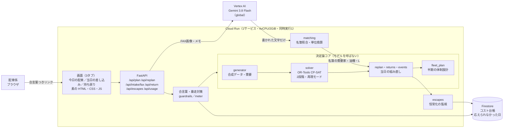
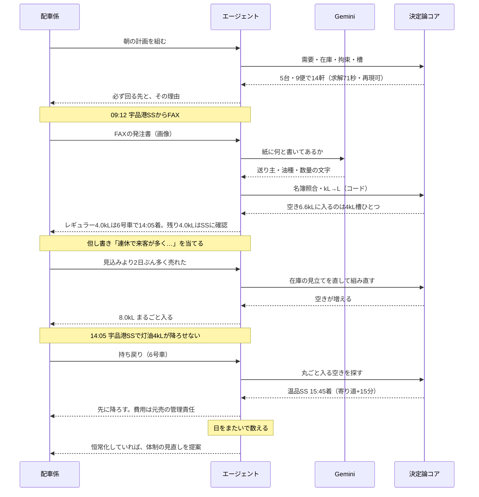

# 応募資料

第5回 Agentic AI Hackathon with Google Cloud への提出物のうち、**想定ユーザー像・
課題・構成図**をここにまとめる。応募フォームと記事の下書きとして使う。

**触れる場所**（審査員に渡すリンク。合言葉は `marifu-lorry-2026`）:

    https://lorry-dispatch-125474373169.us-central1.run.app/?k=marifu-lorry-2026

---

## 1. 誰のための道具か

| | 誰 | いま何をしているか | この道具が返すもの |
|---|---|---|---|
| 主 | **運送会社の配車係** | 毎朝、15〜25軒ぶんの配送を紙と経験で組む。日中は電話とFAXで崩れる | 組んだ計画と、**組み直した理由** |
| 副 | **運送会社の経営** | 半期ごとに元売と専属の台数を決める。外せば自腹 | 何台の専属と待機が要るか、その根拠 |
| 副 | **元売の物流担当** | 需要を見込み、配送を引き当てる | 応えられなかった日の積み上がり |

**主たる利用者は配車係**である。画面は配車係が1日じゅう見る前提で作ってある
（白地・高い密度・弱い装飾）。

### 配車係の一日

    04:00-05:00  車庫を出す。24時間受けのSSから順に
    朝           その日の計画を組む（必ず回る先と、その理由）
    日中         FAXで当日発注が入る。電話も鳴るが、発注書が来るまで車は動かさない
    日中         降ろせない荷が出る（持ち戻り）。次の配送がずれても先に降ろす
    夕方         明日へ回した先を確かめる
    半期ごと     専属を何台取るかを元売と決める

この道具は、このうち**朝・日中・半期**の3つを受け持つ。

---

## 2. 何が難しいのか

配車係が毎朝やっているのは、次を**同時に**満たす組み合わせを見つける仕事である。

1. **槽への製品割当と槽容量** — 槽1つに1油種。混ぜられない。2kL・4kLの組合せで、
   **その槽の全量が入らなければ、その槽は降ろさない**
2. **需要家の受入時間枠と受入可能量** — 運送会社営業所は朝の出庫前しか受けない
3. **乗務員の拘束時間** — 改善基準告示（拘束13時間・運転9時間・連続4時間で30分）
   **＋労働基準法34条の休憩**（労働8時間超で1時間）。両者は足さず、大きいほうを取る
4. **タンク在庫の発注点** — 割ったら今日行く
5. **油槽所の積込回数と回転**

ここに、寒波（灯油が跳ねる）、値上げ発表（駆け込み）、乗務員の欠勤、工事や事故が乗る。
**1つ動くと全部が動く。**

### すでにある道具では届かないところ

| よくある道具 | 届かないところ |
|---|---|
| 配車の最適化ソルバー | 「なぜその計画か」を配車係の言葉で説明しない。外の変化を自分で取りに行かない |
| LLM に配車を書かせる | 数字が合わない。**槽の単位も拘束時間も守らない**。同じ入力で同じ答えが返らない |
| 人の経験 | 属人化する。半期の台数交渉に持っていける根拠が残らない |

### いちばん効くのは「断れること」

配車係の仕事は、運ぶことと同じだけ**運べないと言うこと**でできている。タンクが
空いていなければ運べない。拘束が尽きれば運べない。**そのとき理由を添えて人に返せるか**が、
道具として使えるかどうかを分ける。言われた量をそのまま運ぶ道具は、現場では使えない。

---

## 3. どう解いたか

### 設計の中心にある一線

**計算はすべてコード。モデルは読むだけ。**

    Gemini がやること        紙に何と書いてあるか（文字を写す・分類する）
    コードがやること          名簿の照合・油種の判別・kL→Lの換算・積載・時刻・費用

需要家の取り違えは配車の事故に直結する。「宇品港」と「宇品」をモデルが気を利かせて
寄せると、違うSSに油を運ぶ。**候補が1つに絞れなければ、寄せずに確認を求める**
（`core/matching.py`）。量の換算も計算なので、モデルに任せない。

### 同じ入力なら同じ計画が返る

配車の最適解は同点が多く、実時間で打ち切ると機械が違えば別の計画が出る。
**探索量（決定論的時間）で打ち切る再現モード**を用意し、計画自身に
「同じ入力で同じ計画が返るか」を申告させている。**言えないことは言わない。**

本番で2回続けて走らせ、担当・便・時刻まで完全一致することを確認済み
（2026-09-19、求解 71.1／70.5秒）。

### 自律性はどこにあるか

| | 何を | どこで |
|---|---|---|
| 当日 | 発注・持ち戻り・「見込みより売れた」を取り込んで組み直す | `core/replan.py` `core/returns.py` `core/events.py` |
| 当日 | **入る分だけ入れ、入らない分は理由を添えて突き返す** | 同上 |
| 日をまたいで | 応えられなかった日を数え、**恒常化を見つける** | `app/escapes.py` |
| 半期 | 専属と待機の非専属を何台取るかを掃引で出す | `core/fleet_plan.py` `scripts/size_carrier.py` |

**日をまたいだ監視が新規性の核である。** 1日ずつ見ていると、どの日も「今日は
仕方がない」で済む。日をまたいで数えて初めて、**一時的な逃げ道か、構造の欠陥か**が
分かれる。恒常化していれば、当日の工夫ではなく体制（専属の台数・配送圏）の
見直しを提案する。

---

## 4. 構成図

応募フォームに貼る画像: [images/architecture.png](images/architecture.png)
（SVG: [images/architecture.svg](images/architecture.svg)。下のMermaidから書き出している）

**Google Cloud の使い方**（応募要件）:

| 要件 | 使ったもの | どこで |
|---|---|---|
| 実行環境 | **Cloud Run** | 画面とAPIを1サービスで。4vCPU・2GiB・同時実行1・最大3インスタンス |
| AI | **Vertex AI / Gemini 3.8 Flash** | FAXの読み取りとメモの分類のみ（`global` エンドポイント） |
| その他 | **Firestore** | コスト台帳と、応えられなかった日の記録 |
| その他 | **Cloud Build / Artifact Registry** | コンテナの構築と配布 |

### 暴走対策（設計の前提）

エージェントを外に出す以上、URLを知った誰かが叩き続けるだけで請求が伸びる。
**過去に別プロジェクトで、無料クレジットの半分を一度の暴走で失っている。**

    1リクエスト $0.10 ／ 利用者ごと1日 $0.50 ／ 全体1日 $2.00 ／ 全体1か月 $15.00

GCPの予算アラートは**通知するだけで支出を止めない**。止まるのはこの台帳だけである。
公開URLには合言葉（環境変数 `DEMO_KEY`）も置いた。

---

## 5. 一日の流れ（デモの筋）

画像: [images/flow_of_a_day.png](images/flow_of_a_day.png)

---

## 6. 実装の状態（正直に）

| | 状態 |
|---|---|
| 当日の配車・組み直し・持ち戻り・体制設計 | **動く**（本番で確認済み） |
| 画面 | **動く**（3タブ） |
| FAX読み取り | **動く**（実Gemini・1枚0.27円） |
| 二交代（車と乗務員を別資源にする） | **未実装**。いまは1台1名 |
| 休息期間（継続11時間） | **未実装**。翌日の開始時刻を縛れていない |
| 雪 | **未実装** |
| 交通の確率モデル・等時線 | **見送り**（体制設計層を優先した） |

数字の出どころと、どこまで裏が取れているかは [業務前提.md](業務前提.md) に
法令／実務／仮置の3区分で書いてある。**仮置のまま残している項目もそのまま載せている。**

---

## 7. 題材について

元・石油会社の情報システム部門（製油所勤務25年）の経験から題材を選んだ。
需要家名・座標・タンク容量・消費量はすべて**合成データ**で、実在の事業所の実績値では
ない。**地理だけは合成していない**——「岩国から浜田まで灯油を運ぶと拘束時間が厳しい」
という制約の効き方は、実際の距離でなければ成立しないからである。
